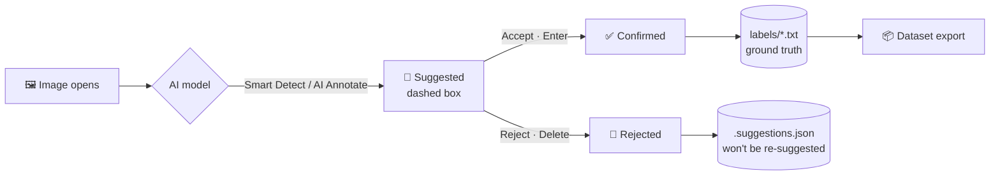

<div align="center">

# 🎯 AnnoMaster

### AI-assisted image annotation platform for YOLO datasets

Label faster with **Smart Detect** (your own YOLO models) and **AI Annotate** (SAM3 text & box prompting) —
while every AI prediction stays a *suggestion* until a human accepts it.


[Features](#-features) · [Quick start](#-quick-start) · [AI setup](#-ai-setup) · [How it works](#-how-it-works) · [Project structure](#-project-structure)

</div>

---

## ✨ Features

| | |
|---|---|
| 🖊️ **Fast bounding-box annotation** | Draw, resize, nest boxes; keyboard shortcuts; undo/redo; auto-save to YOLO `.txt` |
| 🤖 **Smart Detect** | Runs your own YOLO `.pt` model on every image as it opens. Drop a model into `models/` — it appears without restarting |
| 💬 **AI Annotate — text prompts** | Type *"excavator, person, forklift"* and SAM3 finds them. A live confidence slider filters results instantly |
| 📦 **AI Annotate — box prompts** | Draw a few example boxes (*"this is"* / *"not this"*) and the app labels matching objects on every image — even look-alike classes like *staff* vs *customer* |
| ✅ **Human-in-the-loop by design** | AI output is a dashed **suggestion** until you accept it. Exports contain **only human-confirmed** labels |
| ⚡ **GPU or CPU — never an error** | Uses CUDA (fp16) when available and falls back to CPU automatically, including on out-of-memory |
| 🎞️ **Video to frames** | Upload MP4 / AVI / MOV / MKV / DAV (CCTV) and extract frames with ffmpeg |
| 👥 **Multi-user workspaces** | Owner / editor / viewer roles, member invites, annotation locks and an audit log |
| 🗂️ **Datasets & versions** | Train / valid / test splits, immutable version snapshots with `data.yaml`, one-click export |
| 🎨 **Themes** | Dark, light and custom accent colours, built on a single design-token layer |
| 🔐 **Secure accounts** | JWT auth, bcrypt passwords, stateless password-reset links |

---

## 🚀 Quick start

**Requirements:** Python 3.10+, [ffmpeg](https://ffmpeg.org/download.html) on your `PATH` (for video).

```bash
git clone https://github.com/ChandraMahesh24/Annomaster1.git
cd Annomaster1

python -m venv venv
venv\Scripts\activate            # Windows
# source venv/bin/activate       # Linux / macOS

pip install -r requirements.txt
cp .env.example .env             # then set SECRET_KEY and JWT_SECRET
python run.py
```

Open **http://localhost:5000** and:

1. **Register** an account
2. Create a **Workspace** from the dashboard
3. Create a **Project** and upload images or a video
4. Open the project and start annotating ✍️

> ⚠️ Install **`PyJWT`**, not the unrelated `jwt` package. If login fails with
> `module 'jwt' has no attribute 'encode'`, run `pip uninstall jwt && pip install PyJWT`.

---

## 🧠 AI setup

### Smart Detect (YOLO)
Put any Ultralytics YOLO checkpoint (`.pt`) in **`models/`**. It shows up in the Smart Detect bar on the next page refresh. Model, confidence, IoU and mode (*Review* or *Auto-approve*) are saved per project.

### AI Annotate (SAM3)
SAM3 weights are not downloaded automatically. Place **`sam3.pt`** (≈3.45 GB) in `models/` or next to `run.py`.

### GPU acceleration (optional)
`requirements.txt` installs the CPU build of PyTorch. For an NVIDIA GPU, install the CUDA build first:

```bash
pip install torch==2.14.1+cu130 torchvision==0.29.1+cu130 --index-url https://download.pytorch.org/whl/cu130
```

| Task | GPU (RTX 3050 6 GB, fp16) | CPU |
|---|---|---|
| SAM3 text prompt | ~0.65 s per phrase | ~15–20 s |
| Box-prompt prediction | ~1 s per image | ~22–40 s |
| Smart Detect (YOLO) | ~0.02 s | fast |

> On Windows, **Smart App Control** must be off for the CUDA build of PyTorch to load.

Optional `.env` settings:

```ini
AI_DEVICE=auto        # auto | cpu | cuda | cuda:1
AI_HALF=auto          # auto = fp16 on GPU, 0 = always fp32
AI_APPEARANCE=dinov2  # class judge for box prompts: dinov2 | sam3
```

---

## 🔍 How it works

### A prediction is a suggestion — never a label — until a human accepts it



- Only **confirmed** boxes are written to the YOLO `.txt` files, so exports and dataset versions can never contain unreviewed AI output.
- **Editing a suggestion counts as accepting it.**
- Re-running a model is safe: it never duplicates or overwrites boxes a human has confirmed.

### Box prompting: teach by example
1. Open **AI Annotate → Box** and pick **This is** or **Not this**.
2. Draw a box around one object and choose its class.
3. Every image you open is now labelled from your examples: **SAM3** finds the objects and **DINOv2** decides which class each one is.
4. Add more examples to improve accuracy. In testing, going from 3 to 6 example frames raised class accuracy from 76 % to 86 %.

---

## 🗂️ Project structure

```
annomaster/
├── run.py                  Entry point
├── config.py               Settings (reads .env)
├── app/
│   ├── api/                Thin HTTP route handlers
│   ├── core/               Business logic (paths, YOLO I/O, datasets, AI models, devices)
│   ├── models/             SQLAlchemy models (users, workspaces, locks, audit)
│   └── utils/              JWT security, errors, logging
├── static/
│   ├── css/                tokens.css → base.css → layout.css → page sheets → modes.css
│   └── js/                 main.js (annotation engine) + features/*
├── templates/              Jinja pages (auth, dashboard, annotate SPA, settings)
├── models/                 YOLO / SAM3 weights
├── scripts/                Migration, backup and consistency-check tools
└── workspace/              Your images and labels (not committed)
```

### Data layout on disk

```
workspace/<WS-XXXXXX>/projects/<project>/
  Active_Work/job_<DATETIME>/{images,labels}/            ← work in progress
  Completed_Datasets/job_<DATETIME>/{train,valid,test}/  ← finished splits
  Versions/<name>/                                       ← immutable snapshots + data.yaml
```

Annotations live on disk in standard **YOLO format**, ready for `yolo train`. The database stores only users, workspaces, membership, locks and audit history.

---

## 👥 Roles

| Action            | Owner | Editor | Viewer |
|-------------------|:-----:|:------:|:------:|
| Annotate          | ✅ | ✅ | 👁️ view only |
| Upload / import   | ✅ | ✅ | ✗ |
| Manage classes    | ✅ | ✅ | ✗ |
| Invite members    | ✅ | ✗ | ✗ |
| Change roles      | ✅ | ✗ | ✗ |
| Delete workspace  | ✅ | ✗ | ✗ |

---

## 🛠️ Maintenance

```bash
python migrate_db.py                 # add new columns/tables to an existing DB (safe to re-run)
python scripts/check_consistency.py  # report DB ↔ filesystem drift
python scripts/backup.py             # snapshot the database + workspace folder
```

---

## 🧰 Tech stack

**Backend:** Flask · SQLAlchemy · SQLite (WAL) · PyJWT · ffmpeg
**AI:** PyTorch · Ultralytics YOLO · SAM3 · DINOv2 (timm) · OpenAI CLIP
**Frontend:** Vanilla JavaScript · HTML5 Canvas · CSS design tokens · three.js (login scene)

> 🚧 A port to **FastAPI + Postgres + Celery + React** is in progress in `annomaster-next/`.

---

<div align="center">

Made with ❤️ by **[ChandraMahesh24](https://github.com/ChandraMahesh24)**

⭐ If this project helps you, give it a star!

</div>
