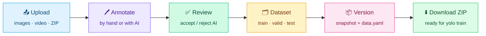
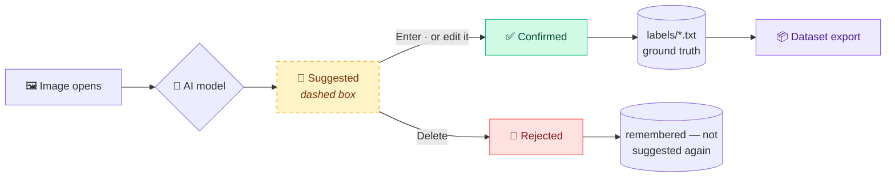
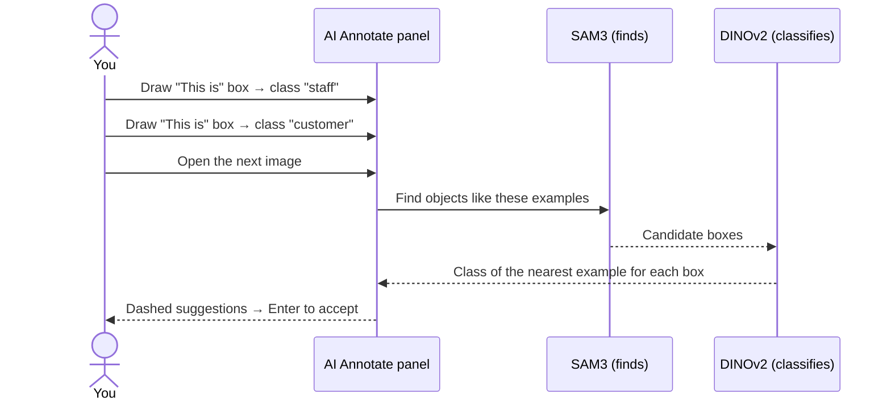
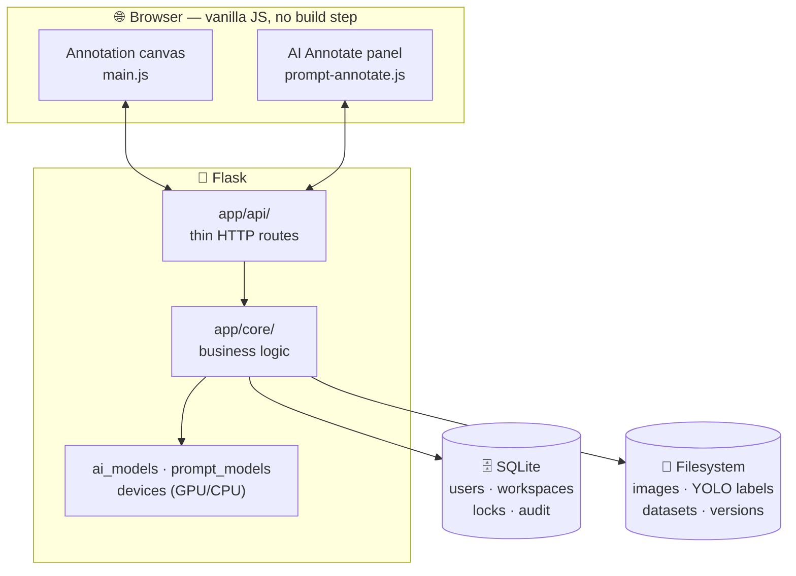

<a id="top"></a>

<div align="center">



<br/>

<p>
  <b>A complete image-annotation studio for YOLO: label by hand, label with AI, export clean datasets.</b><br/>
  <sub>Draw boxes and polygons manually, let your own YOLO model or SAM3 suggest labels, review them, split the data, and download a training-ready version.</sub>
</p>

<p>
  
  
  
  
</p>
<p>
  
  
  
  
  
  
</p>

<h3>
  <a href="#-features-at-a-glance">Features</a>
  <span> · </span>
  <a href="#%EF%B8%8F-manual-annotation">Manual Annotation</a>
  <span> · </span>
  <a href="#-ai-assisted-labelling">AI Labelling</a>
  <span> · </span>
  <a href="#-quick-start">Quick Start</a>
  <span> · </span>
  <a href="#%EF%B8%8F-keyboard-shortcuts">Shortcuts</a>
  <span> · </span>
  <a href="#%EF%B8%8F-architecture">Architecture</a>
</h3>

</div>

<br/>

## 🔄 The Workflow



## ✨ Features at a Glance

<table>
<tr>
<td width="33%" valign="top">

#### 🖊️ Manual annotation
Bounding boxes & polygons, select/move/resize, nested boxes, repeat-class mode, copy/paste, undo/redo, auto-save, null images

</td>
<td width="33%" valign="top">

#### 🤖 AI-assisted labelling
**Smart Detect** with your YOLO model, **SAM3 text prompts**, **box prompts** that learn from your examples

</td>
<td width="33%" valign="top">

#### ✅ Safe by design
AI output is a *suggestion* until you accept it. Exports contain **only human-confirmed** labels

</td>
</tr>
<tr>
<td valign="top">

#### 📤 Upload & import
Images, folders, **video → frames** (FPS, resolution, JPG/PNG), and **YOLO dataset ZIPs** with split detection

</td>
<td valign="top">

#### 🗂️ Datasets & versions
Train / valid / test split sliders, tags, filters, immutable **version snapshots** with `data.yaml`, ZIP download

</td>
<td valign="top">

#### 👥 Team workspaces
Owner / editor / viewer roles, invites, batch **assignment**, per-image **locks**, audit log

</td>
</tr>
<tr>
<td valign="top">

#### ⚡ GPU or CPU
CUDA + fp16 when available, automatic CPU fallback — even on out-of-memory

</td>
<td valign="top">

#### 🎨 Personalisation
Dark / light / custom accent themes, compact mode, avatars, box style, grid size

</td>
<td valign="top">

#### 🔐 Accounts
JWT login, password reset by email, profile, change password, delete account

</td>
</tr>
</table>

<div align="right"><a href="#top">⬆ back to top</a></div>

## 🖊️ Manual Annotation

The annotation canvas is a full labelling studio — fast enough to label thousands of frames by hand.

<table>
<tr>
<td width="50%" valign="top">

### 🛠️ Drawing tools
- **Bounding box** <kbd>B</kbd> — drag anywhere to draw, **even inside another box** (nested objects work)
- **Polygon** <kbd>P</kbd> — click points, <kbd>Enter</kbd> to close the shape
- **Select / Edit** <kbd>V</kbd> — move, resize with handles, change class, delete
- **Pan** — hold <kbd>Space</kbd> and drag
- **Lock aspect ratio** while resizing

</td>
<td width="50%" valign="top">

### 🏷️ Classes
- **Class popup** after every box — search, arrow keys, <kbd>Enter</kbd>, or create a new class on the spot
- **Repeat mode** <kbd>R</kbd> — skip the popup and reuse the last class
- Change a box's class with <kbd>C</kbd>
- Rename classes, pick **class colours**, sync classes across the project
- Live **per-class object counts** in the side panel

</td>
</tr>
<tr>
<td valign="top">

### ⚡ Speed features
- **Auto-save** — every change is written to YOLO `.txt` immediately
- **Undo / redo** <kbd>Ctrl</kbd>+<kbd>Z</kbd> / <kbd>Ctrl</kbd>+<kbd>Y</kbd>
- **Copy / paste boxes** <kbd>Ctrl</kbd>+<kbd>C</kbd> / <kbd>Ctrl</kbd>+<kbd>V</kbd> — great for video frames
- **Select all** <kbd>Ctrl</kbd>+<kbd>A</kbd>
- **Mark as Null** <kbd>N</kbd> — "nothing to label here", counted as done

</td>
<td valign="top">

### 🔍 View controls
- **Zoom** <kbd>+</kbd> / <kbd>-</kbd>, **fit** <kbd>F</kbd>, **lock zoom** <kbd>L</kbd> across images
- **Grid overlay** <kbd>G</kbd> with adjustable cell size
- **Show / hide labels** <kbd>T</kbd>
- **Brightness & contrast** sliders for dark or washed-out images
- **Box style** — border width and fill opacity

</td>
</tr>
<tr>
<td valign="top">

### 🖼️ Media library
- Thumbnail sidebar with **paging** (50 / 100 / 200 per page)
- Filter by **annotated / unannotated / null**, by **class** and by **tag**
- **Annotation progress** bar for the job
- Set any image as the **project cover photo**

</td>
<td valign="top">

### 🔒 Working as a team
- Opening an image **locks it** to you, with a heartbeat, so two people never overwrite each other
- Owners can **force-release** a stuck lock
- Viewers can look but not edit

</td>
</tr>
</table>

<div align="right"><a href="#top">⬆ back to top</a></div>

## 🤖 AI-Assisted Labelling

Three ways to let AI do the first pass — all of them produce **suggestions** you review.

<table>
<tr>
<th width="33%">🎯 Smart Detect</th>
<th width="33%">💬 Text prompt</th>
<th width="33%">📦 Box prompt</th>
</tr>
<tr valign="top">
<td>

Runs **your own YOLO `.pt` model** on every image as it opens.

- Upload a model from the UI or drop it into `models/`
- Confidence & IoU sliders
- **Review** mode → suggestions
- **Auto-approve** mode → saved directly (audit-logged)
- Settings saved **per project**
- Draggable, collapsible panel

</td>
<td>

Type what you want: `excavator, person, forklift` — **SAM3** finds them.

- Up to 20 phrases at once
- **Live confidence slider** filters results instantly (no re-run)
- New class names are created automatically
- Auto-predicts each image as you move on

</td>
<td>

Draw a few examples — **“This is”** or **“Not this”** — and pick the class.

- Every image you open gets suggestions from your examples
- Works for **look-alike classes** no word can describe (e.g. *staff* vs *customer*)
- **SAM3 finds** objects, **DINOv2 decides** the class
- 📥 *Use my boxes* turns your confirmed boxes into examples

</td>
</tr>
</table>

### ✅ Review: a prediction is a suggestion until a human accepts it



- Accept one with <kbd>Enter</kbd>, all with <kbd>Shift</kbd>+<kbd>Enter</kbd>; reject with <kbd>Delete</kbd> / <kbd>Shift</kbd>+<kbd>Delete</kbd>.
- **Moving, resizing or re-classing a suggestion accepts it.**
- **AI Annotate suggestions are not kept until you decide:** leave the image or close the panel without accepting and they disappear; open the image again and you get a **fresh** prediction.
- Only **confirmed** boxes reach the YOLO `.txt` files, so a dataset never contains unreviewed AI output.
- Re-running a model never duplicates boxes or overwrites a box a human confirmed.

<details>
<summary><b>📦 How box prompting works</b></summary>
<br/>



Accuracy on a real *staff vs customer* project: **76 %** correct class with 3 example frames → **86 %** with 6. Add **“Not this”** examples to remove false positives. Examples last while the panel is open; closing it clears them.
</details>

<div align="right"><a href="#top">⬆ back to top</a></div>

## 📤 Upload, Datasets & Versions

<table>
<tr>
<td width="33%" valign="top">

### 📤 Upload
- Drag & drop **images** or a whole **folder**
- JPG, PNG, BMP, TIFF, WebP
- **Video → frames** with ffmpeg: MP4, AVI, MOV, MKV, **DAV (CCTV)**, H.264/H.265
  - FPS: 1 · 2 · 5 · 10 · 15 · 24 · 30
  - Size: original · 1080p · 720p · 480p · custom
  - Output: JPG or PNG
- **Identical files are skipped** automatically (MD5 check)
- Each upload is a **batch / job** you can tag and **assign** to a teammate

</td>
<td width="33%" valign="top">

### 📥 Import
- Import an existing **YOLO dataset ZIP**
- Preview before import: images, labels, classes, `data.yaml`
- Detects **train / valid / test** folders and shows how many images have matching labels
- Classes are read from `data.yaml`
- **Duplicate handling**: skip existing, rename new, or overwrite
- Choose to import images, labels, or both, and split right after import

</td>
<td width="33%" valign="top">

### 🗂️ Datasets & versions
- Move finished jobs into **Completed Datasets**
- **Split** with train / valid / test sliders
- **Tags** and filters on batches and datasets
- **Dataset statistics** (images, objects, classes)
- **Versions**: step-by-step wizard → immutable snapshot with `data.yaml` and a README
- **Download** any version as a ZIP

</td>
</tr>
</table>

<div align="right"><a href="#top">⬆ back to top</a></div>

## 🚀 Quick Start

> **Prerequisites:** Python **3.10+** and [**ffmpeg**](https://ffmpeg.org/download.html) on your `PATH` (for video).

```bash
# 1. Clone
git clone https://github.com/ChandraMahesh24/Annomaster1.git
cd Annomaster1

# 2. Create a virtual environment
python -m venv venv
venv\Scripts\activate          # Windows
# source venv/bin/activate     # Linux / macOS

# 3. Install
pip install -r requirements.txt

# 4. Configure
cp .env.example .env           # set SECRET_KEY and JWT_SECRET

# 5. Run
python run.py
```

🎉 Open **<http://localhost:5000>**, then:

| Step | What to do |
|:---:|---|
| **1** | **Register** an account |
| **2** | Create a **Workspace** and invite your team |
| **3** | Create a **Project** and upload images, a video or a YOLO ZIP |
| **4** | Label by hand or turn on **Smart Detect / AI Annotate** |
| **5** | Split into a **dataset**, create a **version**, download and train 🚀 |

<details>
<summary><b>🧠 AI model files</b></summary>
<br/>

| Model | Used for | How to get it |
|---|---|---|
| **Your YOLO `.pt`** | Smart Detect | Upload in the app or put it in `models/` |
| **SAM3** (`sam3.pt`, ≈3.45 GB) | Text & box prompting | Gated by Meta: request access at [huggingface.co/facebook/sam3](https://huggingface.co/facebook/sam3), download `sam3.pt`, then place it in `models/` or next to `run.py`. Without it, AI Annotate explains what's missing; everything else works |
| **DINOv2-small** (85 MB) | Box prompting — picks the class | Downloaded automatically on first use |
| **OpenAI CLIP** | SAM3's text tokenizer | Installed by `requirements.txt` |

Manual annotation needs **none** of these.
</details>

<details>
<summary><b>⬇️ Downloading SAM3 (one-time, ≈3.45 GB)</b></summary>
<br/>

SAM3 is published by Meta on Hugging Face as a **gated** model: anyone can use it, but you must accept its licence first. The app cannot download it for you without your approval.

**1. Request access** (once per Hugging Face account)

1. Sign in or create a free account at [huggingface.co](https://huggingface.co/join).
2. Open **[huggingface.co/facebook/sam3](https://huggingface.co/facebook/sam3)**, read the licence and click **Agree and access repository**.
3. Wait for approval. Meta reviews requests by hand, which can take from minutes to a few days; Hugging Face emails you, and the file list on the page becomes downloadable.

**2. Download `sam3.pt`**

*Option A: browser.* On the model page open **Files and versions**, click **`sam3.pt`** and then the download icon.

*Option B: command line* (resumes if the connection drops, which is useful for a 3.45 GB file):

```bash
# create an access token at https://huggingface.co/settings/tokens (type: Read)
hf auth login                                   # paste the token when asked
hf download facebook/sam3 sam3.pt --local-dir models
```

> `hf` comes with `huggingface_hub`, which `requirements.txt` installs. On older versions the command is `huggingface-cli download …`.

**3. Put it in place**

Place `sam3.pt` in the `models/` folder (Option B already does this) or next to `run.py`. Refresh the annotate page: the AI Annotate panel's engine list changes from **“SAM3 (needs weights)”** to **“SAM3”**. No restart is needed; the app looks for the file on every request.

> **Not committed:** `.gitignore` already excludes `*.pt` in the repo root and `models/` (GitHub rejects files over 100 MB), except small project models such as `models/blackshirt_*.pt`.
</details>

<details>
<summary><b>🎮 GPU acceleration (NVIDIA)</b></summary>
<br/>

`requirements.txt` installs the CPU build of PyTorch. For an NVIDIA GPU, install the CUDA build **first**:

```bash
pip install torch==2.14.1+cu130 torchvision==0.29.1+cu130 --index-url https://download.pytorch.org/whl/cu130
```

> **Windows:** *Smart App Control* must be off, or the CUDA build of PyTorch is blocked from loading.

| Task (1920×1080 frame) | GPU — RTX 3050 6 GB | CPU |
|---|:---:|:---:|
| SAM3 text prompt | **~0.65 s** / phrase | ~15–20 s |
| Box-prompt prediction | **~1 s** / image | ~22–40 s |
| Smart Detect (YOLO) | **~0.02 s** | fast |

The AI panel shows **“Runs on GPU (name)”** or **“Runs on CPU”**.
</details>

<details>
<summary><b>⚙️ All <code>.env</code> settings</b></summary>
<br/>

| Variable | Default | Description |
|---|---|---|
| `SECRET_KEY` | — | Flask secret (**required**) |
| `JWT_SECRET` | — | Signs login tokens (**required**) |
| `DATABASE_URL` | `sqlite:///annomaster.db` | Database location |
| `JWT_EXPIRY_HOURS` | `24` | How long a login lasts |
| `APP_BASE_URL` | *(empty)* | Base of password-reset links, e.g. `https://annotate.example.com`. Empty = the address the browser used. Set it in production |
| `RESET_TOKEN_MINUTES` | `30` | Password-reset link lifetime |
| `MAIL_SERVER` … `MAIL_FROM` | *(empty)* | SMTP settings; empty = reset links are printed to the console |
| `AI_DEVICE` | `auto` | `auto` · `cpu` · `cuda` · `cuda:1` |
| `AI_HALF` | `auto` | `auto` = fp16 on GPU · `0` = always fp32 |
| `AI_APPEARANCE` | `dinov2` | Class judge for box prompts: `dinov2` · `sam3` |

</details>

<details>
<summary><b>⚠️ Login fails with <code>module 'jwt' has no attribute 'encode'</code>?</b></summary>
<br/>

The unrelated `jwt` package is installed instead of **PyJWT**:

```bash
pip uninstall jwt
pip install PyJWT
```
</details>

<div align="right"><a href="#top">⬆ back to top</a></div>

## ⌨️ Keyboard Shortcuts

<table>
<tr><th>🛠️ Tools</th><th>🧭 Navigate & view</th><th>✏️ Edit & review</th></tr>
<tr valign="top">
<td>

| Key | Action |
|---|---|
| <kbd>B</kbd> | Bounding box |
| <kbd>P</kbd> | Polygon |
| <kbd>V</kbd> | Select / edit |
| <kbd>Space</kbd> | Pan (hold) |
| <kbd>R</kbd> | Repeat last class |
| <kbd>N</kbd> | Mark as null |
| <kbd>C</kbd> | Change class |

</td>
<td>

| Key | Action |
|---|---|
| <kbd>D</kbd> / <kbd>→</kbd> | Next image |
| <kbd>A</kbd> / <kbd>←</kbd> | Previous image |
| <kbd>Shift</kbd>+<kbd>→</kbd> / <kbd>←</kbd> | Next / previous page |
| <kbd>+</kbd> / <kbd>-</kbd> | Zoom in / out |
| <kbd>F</kbd> / <kbd>0</kbd> | Fit to screen |
| <kbd>L</kbd> | Lock zoom |
| <kbd>G</kbd> / <kbd>T</kbd> | Grid / labels |

</td>
<td>

| Key | Action |
|---|---|
| <kbd>Ctrl</kbd>+<kbd>Z</kbd> / <kbd>Y</kbd> | Undo / redo |
| <kbd>Ctrl</kbd>+<kbd>C</kbd> / <kbd>V</kbd> | Copy / paste box |
| <kbd>Ctrl</kbd>+<kbd>A</kbd> | Select all |
| <kbd>Ctrl</kbd>+<kbd>S</kbd> / <kbd>S</kbd> | Save now |
| <kbd>Del</kbd> | Delete / reject |
| <kbd>Enter</kbd> | Accept suggestion |
| <kbd>Shift</kbd>+<kbd>Enter</kbd> / <kbd>Del</kbd> | Accept / reject all |

</td>
</tr>
</table>

<sub>Click the <b>Shortcuts</b> button in the toolbar to see this list inside the app.</sub>

<div align="right"><a href="#top">⬆ back to top</a></div>

## 👥 Workspaces & Roles

Organise work as **Workspaces → Projects → Jobs**. Invite teammates by email, assign upload batches to them, and track every action in the audit log.

| Action | Owner | Editor | Viewer |
|---|:---:|:---:|:---:|
| Annotate | ✅ | ✅ | 👁️ view only |
| Upload / import | ✅ | ✅ | ❌ |
| Manage classes | ✅ | ✅ | ❌ |
| Invite members | ✅ | ❌ | ❌ |
| Change roles | ✅ | ❌ | ❌ |
| Delete workspace | ✅ | ❌ | ❌ |

Projects can also be **renamed, duplicated, merged, moved** to another workspace, given a **cover photo**, or deleted.

<div align="right"><a href="#top">⬆ back to top</a></div>

## 🏗️ Architecture



<details>
<summary><b>📂 Folder structure</b></summary>
<br/>

```
annomaster/
├── run.py                  Entry point
├── config.py               Settings (reads .env)
├── app/
│   ├── api/                HTTP routes — auth, workspaces, projects, uploads, media,
│   │                       annotations, classes, datasets, versions, locks, audit, AI
│   ├── core/               Business logic — paths, YOLO I/O, media, datasets, versions,
│   │                       tags, suggestions, AI models, SAM3 prompting, GPU/CPU devices
│   ├── models/             SQLAlchemy — users, workspaces, images, batches, locks,
│   │                       assignments, audit log
│   └── utils/              JWT security, errors, logging
├── static/
│   ├── css/                Design tokens → base → layout → page sheets → modes
│   └── js/                 main.js (annotation engine) + features/*
├── templates/              Login, dashboard, members, annotate app, settings
├── models/                 YOLO / SAM3 weights
├── scripts/                Migration, backup and consistency-check tools
└── workspace/              Your images and labels (not committed)
```
</details>

<details>
<summary><b>💾 Data layout on disk</b></summary>
<br/>

```
workspace/<WS-XXXXXX>/projects/<project>/
├── Active_Work/job_<DATETIME>/
│   ├── images/
│   └── labels/          <name>.txt  ← confirmed boxes (YOLO format)
├── Completed_Datasets/job_<DATETIME>/
│   └── train/ valid/ test/  → images/ + labels/
├── Versions/<name>/     ← immutable snapshot + data.yaml
└── project.json
```

Annotations stay on disk in standard **YOLO format**. The database stores only users, workspaces, membership, locks and audit history.
</details>

<details>
<summary><b>🛠️ Maintenance commands</b></summary>
<br/>

```bash
python migrate_db.py                 # add new columns/tables to an existing DB (safe to re-run)
python scripts/check_consistency.py  # report database ↔ filesystem drift
python scripts/backup.py             # snapshot the database + workspace folder together
```
</details>

<div align="right"><a href="#top">⬆ back to top</a></div>

## 🧰 Tech Stack

<div align="center">

| Layer | Technologies |
|:---:|:---|
| **Backend** | Flask · SQLAlchemy · SQLite (WAL) · PyJWT · ffmpeg |
| **AI** | PyTorch · Ultralytics YOLO · SAM3 · DINOv2 (timm) · OpenAI CLIP |
| **Frontend** | Vanilla JavaScript · HTML5 Canvas · CSS design tokens · three.js |

</div>

## 🗺️ Roadmap

- [x] Manual box & polygon annotation with auto-save
- [x] Video → frame extraction and YOLO ZIP import
- [x] Dataset splits, tags and version snapshots
- [x] Team workspaces, roles, assignment and locks
- [x] Smart Detect with custom YOLO models
- [x] SAM3 text prompting and box prompting with an example library
- [x] Automatic GPU / CPU selection
- [ ] Batch AI prediction over a whole job
- [ ] Per-user statistics dashboard in the UI
- [ ] FastAPI + Postgres + React version (in progress in `annomaster-next/`)

<br/>

<div align="center">

### ⭐ If AnnoMaster saves you time, give it a star!

Built by **[ChandraMahesh24](https://github.com/ChandraMahesh24)**

<a href="#top">⬆ back to top</a>

</div>
