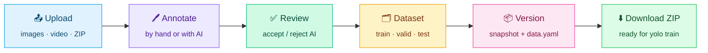

<a id="top"></a>

<div align="center">


<br/>

<p>
  <b>A complete image-annotation studio for YOLO: label by hand, label with AI, export clean datasets.</b>
</p>

<p>
  
  
  
  
</p>
<p>
  
  
  
  
</p>

<h3>
  <a href="#overview">Overview</a>
  <span> · </span>
  <a href="#features">Features</a>
  <span> · </span>
  <a href="#quick-start">Quick Start</a>
  <span> · </span>
  <a href="docs/README.md">Documentation</a>
</h3>

</div>

## Overview

**AnnoMaster** is a self-hosted web application for building object-detection datasets in **YOLO format**. Teams upload images or video, label objects by hand or with AI assistance, review every AI suggestion, and export versioned, training-ready datasets.

AI never writes to your dataset on its own: every prediction is a **suggestion** until a person accepts it, so exports contain **only human-confirmed labels**.



## Features

<table>
<tr>
<td width="33%" valign="top">

#### 🖊️ Manual annotation
Boxes and polygons, nested boxes, class popup, repeat mode, copy/paste, undo/redo, auto-save, null images.
<br/><sub><a href="docs/annotation.md">Learn more →</a></sub>

</td>
<td width="33%" valign="top">

#### 🤖 AI-assisted labelling
**Smart Detect** with your own YOLO model, **SAM3 text prompts**, and **box prompts** that learn from your examples.
<br/><sub><a href="docs/ai-labelling.md">Learn more →</a></sub>

</td>
<td width="33%" valign="top">

#### ✅ Safe by design
AI output is a suggestion until a person accepts it. Exports contain only human-confirmed labels.
<br/><sub><a href="docs/ai-labelling.md#reviewing-suggestions">Learn more →</a></sub>

</td>
</tr>
<tr>
<td valign="top">

#### 📤 Upload & import
Images, folders, **video → frames** (incl. CCTV `.dav`), and **YOLO dataset ZIPs** with split detection.
<br/><sub><a href="docs/data-management.md">Learn more →</a></sub>

</td>
<td valign="top">

#### 🗂️ Datasets & versions
Train / valid / test splits, tags, immutable **version snapshots** with `data.yaml`, ZIP download.
<br/><sub><a href="docs/data-management.md#versions-and-download">Learn more →</a></sub>

</td>
<td valign="top">

#### 👥 Team workspaces
Owner / editor / viewer roles, invites, batch assignment, per-image locks, audit log.
<br/><sub><a href="docs/teams.md">Learn more →</a></sub>

</td>
</tr>
<tr>
<td valign="top">

#### ⚡ GPU or CPU
CUDA with half precision when available, automatic CPU fallback, even on out-of-memory.
<br/><sub><a href="docs/installation.md#gpu-acceleration">Learn more →</a></sub>

</td>
<td valign="top">

#### 🎨 Personalisation
Dark, light and custom accent themes, compact mode, box style, grid size.

</td>
<td valign="top">

#### 🔐 Accounts
Email sign-in, password reset by email, profile, change password, delete account.

</td>
</tr>
</table>

## Quick Start

> **Prerequisites:** Python **3.10+** and [**ffmpeg**](https://ffmpeg.org/download.html) on your `PATH`.

```bash
git clone https://github.com/ChandraMahesh24/Annomaster1.git
cd Annomaster1
python -m venv venv
venv\Scripts\activate                              # Linux / macOS: source venv/bin/activate
pip install -r requirements.txt
cp .env.example .env                               # set SECRET_KEY and JWT_SECRET
python run.py
```

Open **<http://localhost:5000>**, register, create a workspace and a project, then upload images, a video or a YOLO ZIP.

Manual annotation works immediately. AI features need model files, and **SAM3** must be downloaded once from Hugging Face; see the **[installation guide](docs/installation.md)** for model files, GPU setup and all settings.

## Documentation

| Guide | |
|---|---|
| 📘 **[Installation & configuration](docs/installation.md)** | Requirements, AI models, downloading SAM3, GPU, `.env`, troubleshooting |
| 🖊️ **[Manual annotation](docs/annotation.md)** | Drawing tools, classes, editing, view controls, media library |
| 🤖 **[AI-assisted labelling](docs/ai-labelling.md)** | Smart Detect, text and box prompts, review rules, performance |
| 📤 **[Upload, datasets & versions](docs/data-management.md)** | Images, video, ZIP import, splits, versions, download |
| 👥 **[Teams & permissions](docs/teams.md)** | Workspaces, roles, locks, project management |
| ⌨️ **[Keyboard shortcuts](docs/keyboard-shortcuts.md)** | Every shortcut in one place |
| 🏗️ **[Architecture](docs/architecture.md)** | System design, folder structure, data layout, maintenance |

## Tech Stack

<div align="center">

| Layer | Technologies |
|:---:|:---|
| **Backend** | Flask · SQLAlchemy · SQLite (WAL) · PyJWT · ffmpeg |
| **AI** | PyTorch · Ultralytics YOLO · SAM3 · DINOv2 (timm) · OpenAI CLIP |
| **Frontend** | Vanilla JavaScript · HTML5 Canvas · CSS design tokens · three.js |

</div>

## Roadmap

- [x] Manual box and polygon annotation with auto-save
- [x] Video → frame extraction and YOLO ZIP import
- [x] Dataset splits, tags and version snapshots
- [x] Team workspaces, roles, assignment and locks
- [x] Smart Detect with custom YOLO models
- [x] SAM3 text prompting and box prompting with DINOv2 classification
- [x] Automatic GPU / CPU selection
- [ ] Batch AI prediction over a whole job
- [ ] Per-user statistics dashboard in the UI
- [ ] FastAPI + Postgres + React version (in progress in `annomaster-next/`)

<br/>

<div align="center">

**If AnnoMaster saves you time, consider giving it a ⭐**

Built by **[ChandraMahesh24](https://github.com/ChandraMahesh24)**

<a href="#top">⬆ Back to top</a>

</div>
