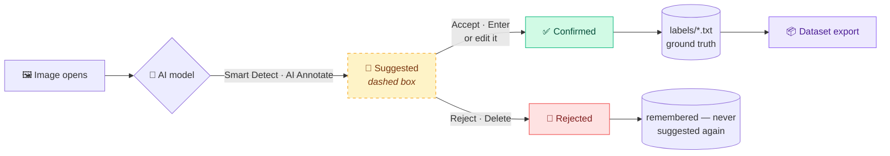
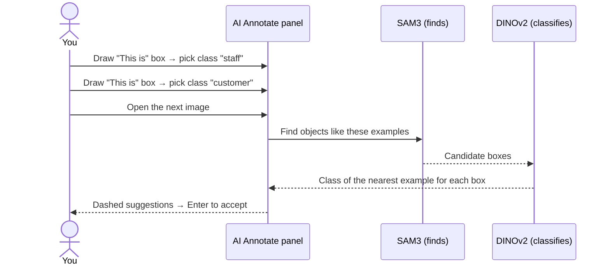
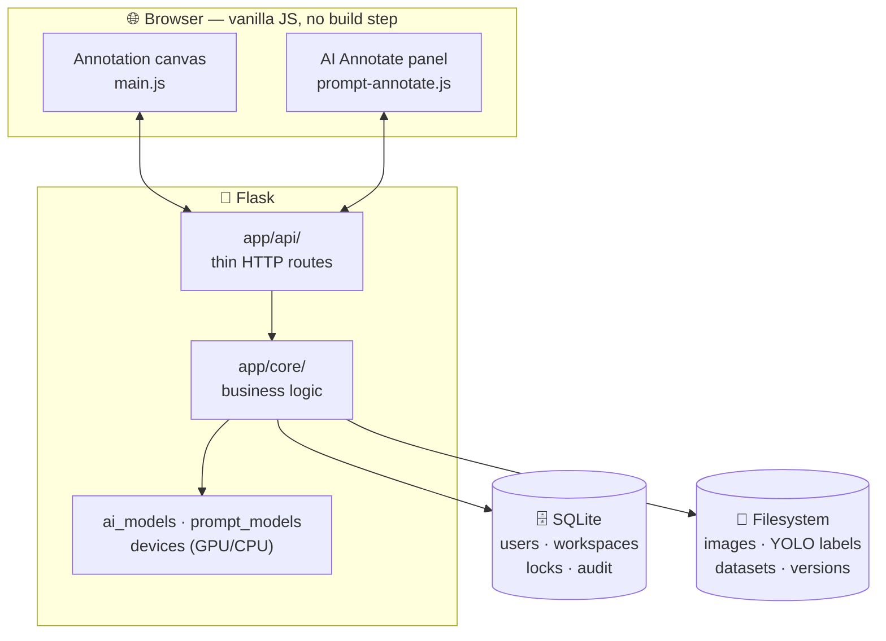

<a id="top"></a>

<div align="center">


<br/>

<p>
  <b>Label images faster with AI — without ever letting a model write your ground truth.</b><br/>
  <sub>Run your own YOLO models, ask SAM3 for objects by name or by example, and export clean YOLO datasets.</sub>
</p>

<p>
  
  
  
  
</p>
<p>
  
  
  
  
  
  
</p>

<h3>
  <a href="#-features">Features</a>
  <span> · </span>
  <a href="#-quick-start">Quick Start</a>
  <span> · </span>
  <a href="#-ai-models">AI Models</a>
  <span> · </span>
  <a href="#-how-it-works">How It Works</a>
  <span> · </span>
  <a href="#%EF%B8%8F-keyboard-shortcuts">Shortcuts</a>
  <span> · </span>
  <a href="#-architecture">Architecture</a>
</h3>

</div>

<br/>

## 💡 Why AnnoMaster?

Most AI-labelling tools quietly turn model output into labels — and a dataset full of unreviewed predictions trains a model that repeats its own mistakes. **AnnoMaster treats every prediction as a _suggestion_.** It's drawn dashed, it's counted as pending, and it **never reaches your exported dataset until a human accepts it**.

You get the speed of AI with a dataset you can still trust.

<br/>

## ✨ Features

<table>
<tr>
<td width="50%" valign="top">

### 🤖 Smart Detect
Run **your own YOLO `.pt` model** on every image as it opens. Drop a new model into `models/` and it appears on refresh — no restart. Choose **Review** (suggestions) or **Auto-approve** (audit-logged).

</td>
<td width="50%" valign="top">

### 💬 Text prompting
Type `excavator, person, forklift` and **SAM3** finds them. A **live confidence slider** filters the results instantly, so there's no waiting for a re-run.

</td>
</tr>
<tr>
<td width="50%" valign="top">

### 📦 Box prompting — teach by example
Draw a few **“This is”** / **“Not this”** example boxes. Every image you open is then labelled from them, even for **look-alike classes** that no word can describe (e.g. *staff* vs *customer*).

</td>
<td width="50%" valign="top">

### ✅ Human-in-the-loop by design
Accept with <kbd>Enter</kbd>, reject with <kbd>Delete</kbd>. Editing a suggestion counts as accepting it. **Exports contain only human-confirmed labels**, always.

</td>
</tr>
<tr>
<td width="50%" valign="top">

### ⚡ GPU or CPU — never an error
Uses **CUDA with fp16** when available. If the GPU fails or runs out of memory, it **falls back to CPU automatically**. The same code runs on any machine.

</td>
<td width="50%" valign="top">

### 🎞️ Images & video
Upload images, or **MP4 / AVI / MOV / MKV / DAV (CCTV)** video and extract frames with ffmpeg. Duplicate images are detected.

</td>
</tr>
<tr>
<td width="50%" valign="top">

### 👥 Team workspaces
**Owner / editor / viewer** roles, member invites, per-image **annotation locks** so two people never overwrite each other, and a full **audit log**.

</td>
<td width="50%" valign="top">

### 🗂️ Datasets & versions
**Train / valid / test** splits, **immutable version snapshots** with `data.yaml`, and one-click export — ready for `yolo train`.

</td>
</tr>
</table>

<div align="right"><a href="#top">⬆ back to top</a></div>

## 🚀 Quick Start

> **Prerequisites:** Python **3.10+** and [**ffmpeg**](https://ffmpeg.org/download.html) on your `PATH` (only needed for video).

```bash
# 1. Clone
git clone https://github.com/ChandraMahesh24/Annomaster1.git
cd Annomaster1

# 2. Create a virtual environment
python -m venv venv
venv\Scripts\activate          # Windows
# source venv/bin/activate     # Linux / macOS

# 3. Install
pip install -r requirements.txt

# 4. Configure
cp .env.example .env           # set SECRET_KEY and JWT_SECRET

# 5. Run
python run.py
```

🎉 Open **<http://localhost:5000>** and:

| Step | What to do |
|:---:|---|
| **1** | **Register** an account |
| **2** | Create a **Workspace** on the dashboard |
| **3** | Create a **Project** and upload images or a video |
| **4** | Open the project and start labelling ✍️ |

<details>
<summary><b>⚠️ Login fails with <code>module 'jwt' has no attribute 'encode'</code>?</b></summary>
<br/>

You have the unrelated `jwt` package installed instead of **PyJWT**. Fix it with:

```bash
pip uninstall jwt
pip install PyJWT
```
</details>

<details>
<summary><b>⚙️ All <code>.env</code> settings</b></summary>
<br/>

| Variable | Default | Description |
|---|---|---|
| `SECRET_KEY` | — | Flask secret (**required**) |
| `JWT_SECRET` | — | Signs login tokens (**required**) |
| `DATABASE_URL` | `sqlite:///annomaster.db` | Database location |
| `JWT_EXPIRY_HOURS` | `24` | How long a login lasts |
| `APP_BASE_URL` | `http://localhost:5000` | Used in password-reset links |
| `RESET_TOKEN_MINUTES` | `30` | Password-reset link lifetime |
| `MAIL_SERVER` … `MAIL_FROM` | *(empty)* | SMTP settings. Empty = reset links are printed to the console |
| `AI_DEVICE` | `auto` | `auto` · `cpu` · `cuda` · `cuda:1` |
| `AI_HALF` | `auto` | `auto` = fp16 on GPU · `0` = always fp32 |
| `AI_APPEARANCE` | `dinov2` | Class judge for box prompts: `dinov2` · `sam3` |

</details>

<div align="right"><a href="#top">⬆ back to top</a></div>

## 🧠 AI Models

| Model | Used for | Where it comes from |
|---|---|---|
| **Your YOLO `.pt`** | Smart Detect | Put it in `models/` |
| **SAM3** (`sam3.pt`, ≈3.45 GB) | Text & box prompting — *finds* objects | Place it in `models/` or next to `run.py` |
| **DINOv2-small** (85 MB) | Box prompting — decides *which class* | Downloaded automatically on first use |
| **OpenAI CLIP** | SAM3's text tokenizer | Installed by `requirements.txt` |

<details>
<summary><b>🎮 Enable GPU acceleration (NVIDIA)</b></summary>
<br/>

`requirements.txt` installs the CPU build of PyTorch. For an NVIDIA GPU, install the CUDA build **first**:

```bash
pip install torch==2.14.1+cu130 torchvision==0.29.1+cu130 --index-url https://download.pytorch.org/whl/cu130
```

> **Windows:** *Smart App Control* must be turned off, or the CUDA build of PyTorch is blocked from loading.

The annotation panel shows **“Runs on GPU (name)”** or **“Runs on CPU”** so you always know which one is in use.
</details>

<details>
<summary><b>📊 Performance (measured)</b></summary>
<br/>

Measured on a 1920×1080 frame, model already loaded:

| Task | GPU — RTX 3050 6 GB, fp16 | CPU |
|---|:---:|:---:|
| SAM3 text prompt | **~0.65 s** per phrase | ~15–20 s |
| Box-prompt prediction | **~1 s** per image | ~22–40 s |
| Smart Detect (YOLO) | **~0.02 s** | fast |
| First SAM3 request after a restart | ~15 s (model load) | longer |

Box-prompting accuracy on a real *staff vs customer* project:

| Example frames | Correct class |
|:---:|:---:|
| 3 | 76 % |
| 6 | **86 %** |

More examples → better classes. Add **“Not this”** examples to remove false positives.
</details>

<div align="right"><a href="#top">⬆ back to top</a></div>

## 🔍 How It Works

### The annotation lifecycle



- 🛡️ Only **confirmed** boxes are written to YOLO `.txt` files, so a dataset can never contain unreviewed AI output.
- 🔁 Re-running a model is safe: it never duplicates boxes or overwrites a box a human confirmed.
- 🚫 Rejected boxes are remembered, so the same wrong prediction doesn't come back.

### Box prompting — teach by example



<div align="right"><a href="#top">⬆ back to top</a></div>

## ⌨️ Keyboard Shortcuts

<table>
<tr><th>Drawing</th><th>Navigation & view</th><th>Review & edit</th></tr>
<tr valign="top">
<td>

| Key | Action |
|---|---|
| <kbd>B</kbd> | Draw boxes |
| <kbd>P</kbd> | Draw polygons |
| <kbd>V</kbd> | Select / edit mode |
| <kbd>R</kbd> | Repeat last class |
| <kbd>N</kbd> | Mark image as null |

</td>
<td>

| Key | Action |
|---|---|
| <kbd>D</kbd> / <kbd>→</kbd> | Next image |
| <kbd>A</kbd> / <kbd>←</kbd> | Previous image |
| <kbd>+</kbd> / <kbd>-</kbd> | Zoom in / out |
| <kbd>F</kbd> / <kbd>0</kbd> | Fit image |
| <kbd>G</kbd> / <kbd>T</kbd> | Grid / labels |

</td>
<td>

| Key | Action |
|---|---|
| <kbd>Enter</kbd> | Accept suggestion |
| <kbd>Shift</kbd>+<kbd>Enter</kbd> | Accept all |
| <kbd>Del</kbd> | Delete / reject |
| <kbd>Shift</kbd>+<kbd>Del</kbd> | Reject all |
| <kbd>Ctrl</kbd>+<kbd>Z</kbd> / <kbd>Y</kbd> | Undo / redo |

</td>
</tr>
</table>

<sub>Also: <kbd>C</kbd> change class · <kbd>S</kbd> save · <kbd>L</kbd> lock zoom · <kbd>Ctrl</kbd>+<kbd>C</kbd>/<kbd>V</kbd> copy/paste box · <kbd>Ctrl</kbd>+<kbd>A</kbd> select all · <kbd>Shift</kbd>+<kbd>←</kbd>/<kbd>→</kbd> previous/next page</sub>

<div align="right"><a href="#top">⬆ back to top</a></div>

## 🏗️ Architecture



<details>
<summary><b>📂 Folder structure</b></summary>
<br/>

```
annomaster/
├── run.py                  Entry point
├── config.py               Settings (reads .env)
├── app/
│   ├── api/                Thin HTTP route handlers
│   ├── core/               Business logic — paths, YOLO I/O, datasets, AI models, devices
│   ├── models/             SQLAlchemy models — users, workspaces, locks, audit
│   └── utils/              JWT security, errors, logging
├── static/
│   ├── css/                Design tokens → base → layout → page sheets → modes
│   └── js/                 main.js (annotation engine) + features/*
├── templates/              Jinja pages — auth, dashboard, annotate app, settings
├── models/                 YOLO / SAM3 weights
├── scripts/                Migration, backup and consistency-check tools
└── workspace/              Your images and labels (not committed)
```
</details>

<details>
<summary><b>💾 Data layout on disk</b></summary>
<br/>

```
workspace/<WS-XXXXXX>/projects/<project>/
├── Active_Work/job_<DATETIME>/
│   ├── images/
│   └── labels/          <name>.txt  ← confirmed boxes (YOLO format)
├── Completed_Datasets/job_<DATETIME>/
│   └── train/ valid/ test/  → images/ + labels/
├── Versions/<name>/     ← immutable snapshot + data.yaml
└── project.json
```

Annotations stay on disk in standard **YOLO format**. The database stores only users, workspaces, membership, locks and audit history.
</details>

<details>
<summary><b>👥 Roles & permissions</b></summary>
<br/>

| Action | Owner | Editor | Viewer |
|---|:---:|:---:|:---:|
| Annotate | ✅ | ✅ | 👁️ view only |
| Upload / import | ✅ | ✅ | ❌ |
| Manage classes | ✅ | ✅ | ❌ |
| Invite members | ✅ | ❌ | ❌ |
| Change roles | ✅ | ❌ | ❌ |
| Delete workspace | ✅ | ❌ | ❌ |
</details>

<details>
<summary><b>🛠️ Maintenance commands</b></summary>
<br/>

```bash
python migrate_db.py                 # add new columns/tables to an existing DB (safe to re-run)
python scripts/check_consistency.py  # report database ↔ filesystem drift
python scripts/backup.py             # snapshot the database + workspace folder together
```
</details>

<div align="right"><a href="#top">⬆ back to top</a></div>

## 🧰 Tech Stack

<div align="center">

| Layer | Technologies |
|:---:|:---|
| **Backend** | Flask · SQLAlchemy · SQLite (WAL) · PyJWT · ffmpeg |
| **AI** | PyTorch · Ultralytics YOLO · SAM3 · DINOv2 (timm) · OpenAI CLIP |
| **Frontend** | Vanilla JavaScript · HTML5 Canvas · CSS design tokens · three.js |

</div>

## 🗺️ Roadmap

- [x] Smart Detect with custom YOLO models
- [x] SAM3 text prompting
- [x] Box prompting with an example library
- [x] Automatic GPU / CPU selection
- [ ] Batch prediction over a whole job
- [ ] Map a text prompt to a different class name
- [ ] FastAPI + Postgres + React version (in progress in `annomaster-next/`)

<br/>

<div align="center">

### ⭐ If AnnoMaster saves you time, give it a star!

Built by **[ChandraMahesh24](https://github.com/ChandraMahesh24)**

<a href="#top">⬆ back to top</a>

</div>
