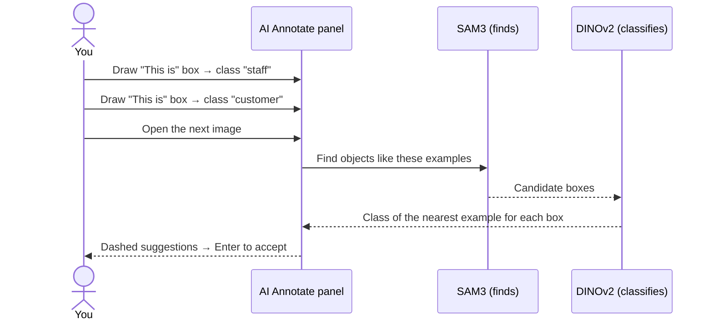
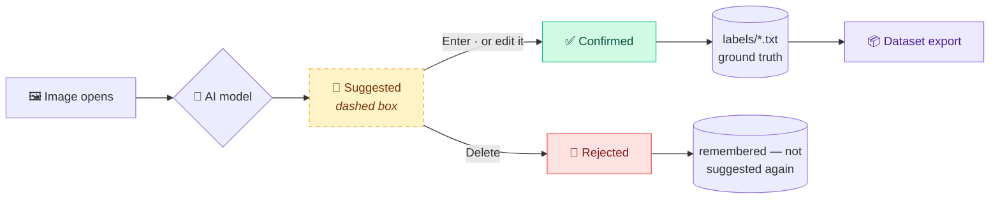

# AI-Assisted Labelling

[← Documentation home](README.md)

AnnoMaster offers three ways to let AI do the first pass. All of them produce **suggestions** that a person reviews; nothing the AI proposes reaches your dataset until someone accepts it.

- [Overview](#overview)
- [Smart Detect](#smart-detect)
- [AI Annotate: text prompts](#ai-annotate-text-prompts)
- [AI Annotate: box prompts](#ai-annotate-box-prompts)
- [Reviewing suggestions](#reviewing-suggestions)
- [Performance](#performance)

Model files and GPU setup are covered in **[Installation](installation.md#ai-model-files)**.

---

## Overview

| | 🎯 Smart Detect | 💬 Text prompt | 📦 Box prompt |
|---|---|---|---|
| **You provide** | a trained YOLO `.pt` model | words, e.g. `excavator, person` | a few example boxes |
| **Model** | your YOLO model | SAM3 | SAM3 finds · DINOv2 classifies |
| **Best for** | classes you have already trained | common objects you can name | look-alike classes no word describes |
| **Runs** | on every image as it opens | on every image as it opens | on every image as it opens |

## Smart Detect

Runs **your own YOLO model** on each image as it opens.

- Upload a model from the UI, or drop the `.pt` file into `models/`; new files appear without a restart.
- Confidence and IoU sliders.
- **Review mode** adds suggestions; **Auto-approve mode** saves detections directly as labels, and every such run is recorded in the audit log.
- Settings are saved **per project**, since different projects detect different objects.
- The panel is draggable and collapsible.

## AI Annotate: text prompts

Open **AI Annotate** in the drawing toolbar, choose **Text prompt** and type what to find, for example `excavator, person, forklift`. SAM3 finds every match.

- Up to 20 phrases at once.
- The **confidence slider filters results instantly** without re-running the model.
- A phrase that matches an existing class name uses that class; otherwise a new class is created.
- With **Predict automatically on each image** switched on, every image you open is predicted from your phrases.

## AI Annotate: box prompts

Box prompting labels objects you can **show** but cannot easily **name**, such as *staff* versus *customer* in a store camera.

1. Open **AI Annotate → Box prompt**.
2. Choose **This is** (an example of a class) or **Not this** (something to stop suggesting).
3. Click **Draw example box**, drag around an example, and pick its class in the same popup used for annotation.
4. Open the next image: it receives suggestions based on your examples.

**📥 Use my boxes** turns the boxes you have already confirmed on the current image into examples in one click.

**How it works.** SAM3 encodes each example on the image where it was drawn and searches new images for similar objects. DINOv2 then compares each candidate with your examples and assigns the class of the closest one; a closer **Not this** example removes the candidate.

**Accuracy.** On a real *staff vs customer* project, measured against human labels on unseen frames, the DINOv2 judge chose the right class for **65 %** of people with examples from 3 frames and **80 %** with examples from 6. More examples give better results.

**Examples last while the panel is open.** Closing AI Annotate clears them, so earlier classes are never suggested in a later session.

## Reviewing suggestions

| Action | Key |
|---|---|
| Accept the selected suggestion | <kbd>Enter</kbd> |
| Accept all on this image | <kbd>Shift</kbd>+<kbd>Enter</kbd> |
| Reject the selected suggestion | <kbd>Delete</kbd> |
| Reject all on this image | <kbd>Shift</kbd>+<kbd>Delete</kbd> |

- **Moving, resizing or re-classing a suggestion accepts it.**
- **AI Annotate suggestions are not kept until you decide.** Leave the image or close the panel without accepting and they disappear; open the image again and you get a fresh prediction.
- Only **confirmed** boxes are written to the YOLO `.txt` files, so a dataset never contains unreviewed AI output.
- Re-running a model never duplicates boxes and never changes a box a person confirmed. Rejected boxes are remembered and not suggested again.

## Performance

| Task (1920×1080 frame) | GPU (RTX 3050, 6 GB) | CPU |
|---|:---:|:---:|
| SAM3 text prompt | ≈0.65 s per phrase | ≈15–20 s |
| Box-prompt prediction | ≈0.9 s per image | ≈22–40 s |
| Smart Detect (YOLO) | ≈0.02 s | ≈0.1 s |

The first AI request after the server starts also loads the model. See [GPU acceleration](installation.md#gpu-acceleration).
