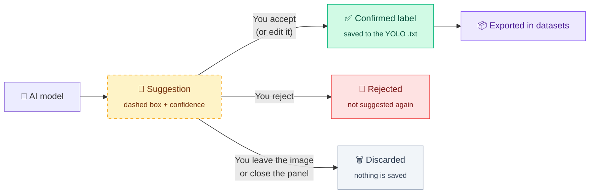
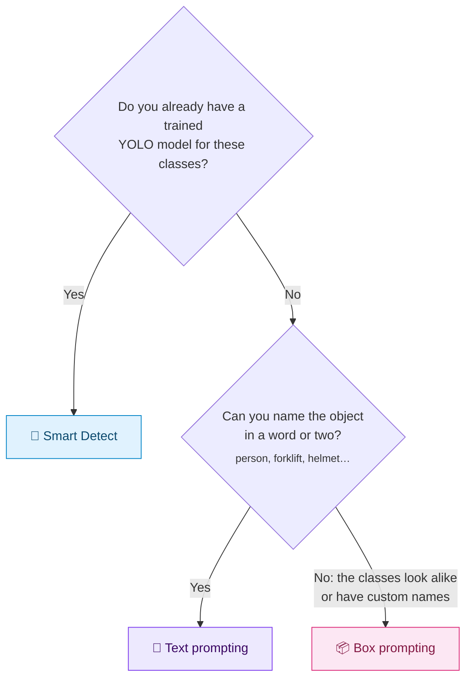
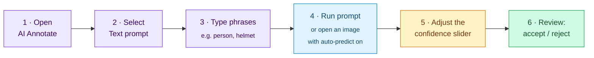
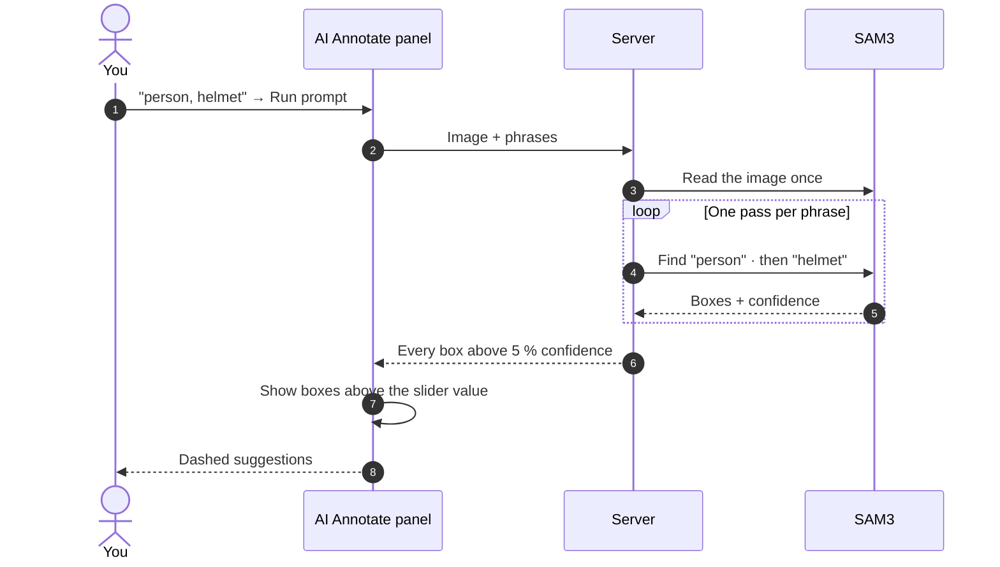
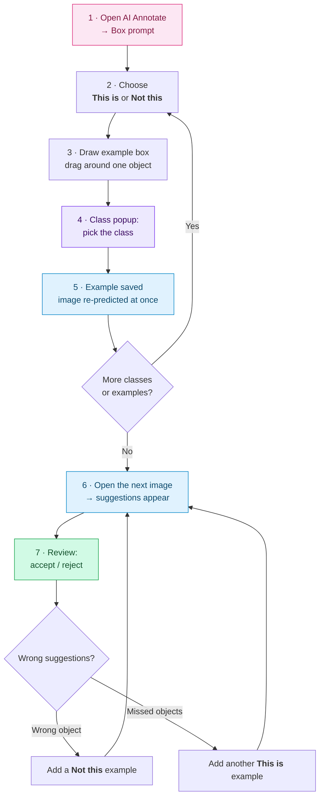
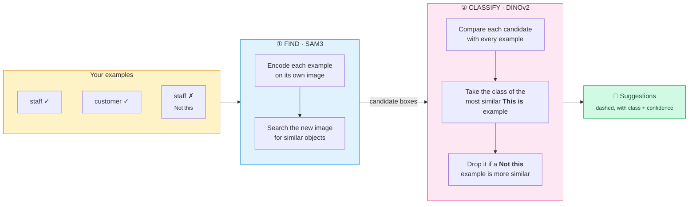
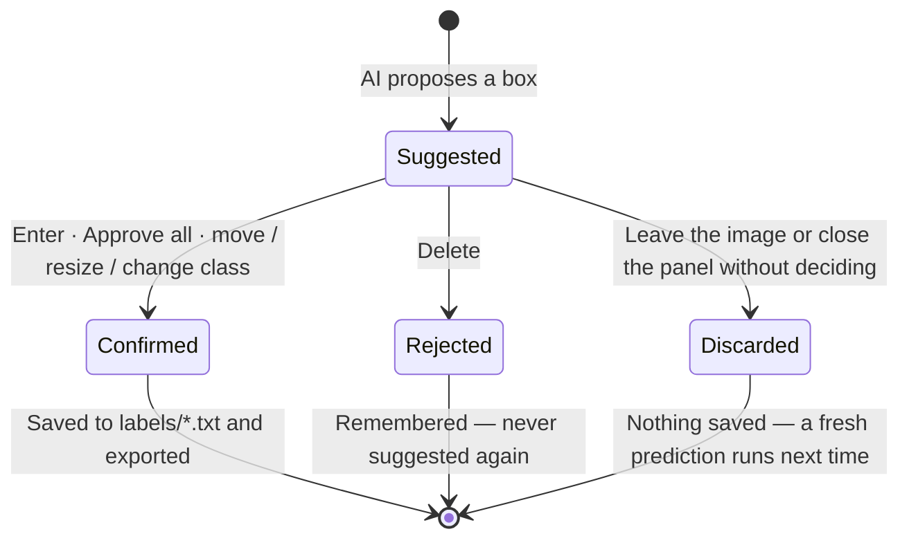

# AI-Assisted Labelling

[← Documentation home](README.md)

AnnoMaster can propose labels for you, so that you review and correct instead of drawing every box by hand. This guide explains the three AI tools, when to use each one, and exactly how to operate **text prompting** and **box prompting**.

**Contents**

1. [Core principle: suggestions, not labels](#1-core-principle-suggestions-not-labels)
2. [Choosing the right tool](#2-choosing-the-right-tool)
3. [The AI Annotate panel](#3-the-ai-annotate-panel)
4. [Text prompting](#4-text-prompting)
5. [Box prompting](#5-box-prompting)
6. [Reviewing suggestions](#6-reviewing-suggestions)
7. [Smart Detect](#7-smart-detect)
8. [Performance and hardware](#8-performance-and-hardware)
9. [Troubleshooting](#9-troubleshooting)
10. [Glossary](#10-glossary)

Model files and GPU setup are described in **[Installation](installation.md#ai-model-files)**.

---

## 1. Core principle: suggestions, not labels

Every box an AI model proposes is a **suggestion**. A suggestion is drawn with a **dashed outline** and its confidence score, and it becomes a real label only when a person **accepts** it.

This guarantees that **datasets and exports contain only human-confirmed labels**, whichever AI tool was used.

## 2. Choosing the right tool

| | 🎯 Smart Detect | 💬 Text prompting | 📦 Box prompting |
|---|---|---|---|
| **You provide** | A trained YOLO `.pt` model | Words, e.g. `forklift, helmet` | A few example boxes |
| **Model** | Your YOLO model | SAM3 | SAM3 finds, DINOv2 classifies |
| **Best for** | Classes you have already trained a model on | Everyday objects you can name | Classes no word describes, e.g. *staff* vs *customer* |
| **Setup effort** | A trained model | None | A few examples per class |
| **Where** | Smart Detect bar | AI Annotate → **Text prompt** | AI Annotate → **Box prompt** |

The tools can be combined. A common workflow is to start a new class with box prompting, label a few hundred images, train a YOLO model on them, and then switch to Smart Detect for the rest.

## 3. The AI Annotate panel

Open the panel with **AI Annotate** in the drawing toolbar (the *Prompt* group). It floats over the canvas and can be **dragged** by its title bar or **collapsed** with the arrow button; its position is remembered.

| Part | Purpose |
|---|---|
| **Engine** (title bar) | The prompting model, currently **SAM3**. Shows *"(needs weights)"* if `sam3.pt` is missing |
| **Text prompt / Box prompt** | Switches between the two prompting methods |
| **Prompt area** | Phrase input (text tab) or the example tools and library (box tab) |
| **Predict automatically on each image** | When on, every image you open is predicted without pressing *Run* |
| **Confidence** slider | Hides suggestions below the chosen confidence (5–95 %, default 40 %) |
| **Run prompt** | Predicts the current image now; shows a live seconds counter while working |
| **Approve N Predictions** | Accepts every visible suggestion on the image at once |
| **Status line** | Shows the device (*Runs on GPU* / *Runs on CPU*), the last result and any messages |

---

## 4. Text prompting

### 4.1 What it does

You describe what to find in plain words; SAM3 searches the image for every matching object and returns one suggestion per object. Each phrase becomes the **class** of the boxes it finds.

**Use it for** objects with a clear, common name: *person, car, forklift, helmet, excavator, bag*.

### 4.2 Step by step

1. Open **AI Annotate** in the drawing toolbar.
2. Select the **Text prompt** tab.
3. Type what to find in the box *"What should it find?"* and press <kbd>Enter</kbd>. Each phrase appears as a chip.
   - Several phrases at once: separate them with commas, e.g. `person, helmet, forklift`.
   - Remove a chip with its **×**, or press <kbd>Backspace</kbd> in the empty input to remove the last one.
4. Press **Run prompt**. With *Predict automatically on each image* switched on, every image you open is predicted for you.
5. Move the **Confidence** slider to show more or fewer suggestions; the result updates instantly.
6. Review the suggestions: <kbd>Enter</kbd> accepts, <kbd>Delete</kbd> rejects, or **Approve N Predictions** accepts all of them.

Your phrases are saved with the project, so they are still there the next time you open the panel.

### 4.3 How it works

- The image is analysed **once**; each phrase is then searched separately, which keeps memory use low.
- The server returns every box above **5 %**. The confidence slider only **filters** this list, which is why moving it is instant and never re-runs the model.
- Raising the slider hides suggestions you have not accepted; a suggestion you have **accepted stays**, whatever the slider says.

### 4.4 Classes

- A phrase that matches an existing class name (ignoring upper and lower case) uses **that class**: `Person` labels boxes as your existing `person` class.
- A phrase that matches no class **creates a new class** with that name, saved to the project.
- To label with a specific existing class, type its exact name.

### 4.5 Writing good phrases

| ✅ Works well | ⚠️ Works poorly | Why |
|---|---|---|
| `person` | `people walking near the counter` | Short nouns match best |
| `forklift` | `vehicle` | Specific beats generic |
| `safety helmet` | `tree` on a forest image | Very common objects produce many low-value boxes; raise the slider |
| `excavator` | `1_staff` | The model does not know your class codes: use box prompting |

### 4.6 Limits and messages

| Situation | What you see |
|---|---|
| No phrase entered | *Type what to look for, e.g. "person, helmet".* |
| More than **20** phrases | *Too many phrases (N) — use at most 20 per run.* |
| A phrase longer than **64** characters | *"…" is too long — keep each phrase under 64 characters.* |
| Nothing found | *Nothing matched. Try different wording, a different example box, or a lower confidence.* |

---

## 5. Box prompting

### 5.1 What it does

You **show** the model what each class looks like by drawing a few example boxes, and it suggests labels on other images from those examples. No word is needed, so box prompting works for classes that look alike or have custom names, such as *staff* versus *customer* in a store camera, or one product variant versus another.

### 5.2 Key concepts

| Term | Meaning |
|---|---|
| **Example** | A box you draw around one object, with its class. Examples are prompts, never labels: they are not saved to your annotations and never exported |
| **This is** | A *positive* example: "find objects like this one, of this class" |
| **Not this** | A *negative* example: "stop suggesting objects like this one for this class" |
| **Example library** | All examples of the current session. They apply to **every** image, not only the one they were drawn on |
| **Session** | The library lasts while the panel is open. **Closing the panel clears it**, so a later task never receives suggestions for earlier classes |

### 5.3 Step by step

1. Open **AI Annotate** and select the **Box prompt** tab.
2. Choose **This is** (the usual case) or **Not this**.
3. Click **Draw example box**, then drag a box tightly around one object on the image.
4. The **class popup** opens, the same one used for annotation. Pick the class with the mouse, the arrow keys and <kbd>Enter</kbd>, or by typing its name. <kbd>Esc</kbd> discards the box. (With **Repeat mode** on, the popup is skipped and the last class is used.)
5. The example is saved, appears on the image with a tag such as *example: staff*, and the image is predicted again straight away so you can see what it learned.
6. Repeat for each class: 2–3 examples per class is a good start. You can draw examples on any image, and examples from different images work together.
7. Open the next image. With *Predict automatically on each image* on, suggestions appear by themselves.

**Shortcut: 📥 Use my boxes.** Turns every box you have already **confirmed** on the current image into examples, each with its own class. This is the fastest way to teach the model from work you have already done.

### 5.4 How it works

Box prompting works in two stages: one model **finds** objects, a second **decides** their class.

- **Stage 1, SAM3**, looks at each example on the image where you drew it, learns "objects like these", and finds all similar objects on the new image. It does not need a word.
- **Stage 2, DINOv2**, is a model specialised in visual similarity. It compares each candidate with all of your examples (clothing, colour, shape) and assigns the class of the closest **This is** example. If a **Not this** example of that class is closer still, the candidate is removed.
- Encoded examples are cached on the server, so after the first image each new image only needs the search and the comparison.

### 5.5 Getting good results

| Tip | Why |
|---|---|
| Give **2–3 examples per class**, then add more where it makes mistakes | Accuracy grows with examples (see below) |
| Take examples from **different images**: different positions, lighting, poses | The model learns the class, not one particular picture |
| Draw boxes **tightly** around the whole object | The comparison uses what is inside the box |
| Use **Not this** for repeated false positives, e.g. passers-by you do not label | Removes that kind of object from future suggestions |
| Keep the classes in one session related | Close the panel before starting an unrelated task: the library is cleared |

**Measured accuracy.** On a real *staff vs customer* store-camera project, compared with human labels on images the model had not seen:

| Examples taken from | Correct class (judged on the true boxes) |
|---|:---:|
| 3 images | **65 %** |
| 6 images | **80 %** |

### 5.6 Managing examples

| Action | How |
|---|---|
| See the library | The list in the Box prompt tab: one row per class, e.g. *staff · 6 examples · 1 not* |
| Remove all examples of a class | **×** at the end of the class row |
| Remove the examples drawn on this image | The **eraser** button |
| Clear everything | Close the AI Annotate panel |

Limits: up to **200** examples per project. An example box must be at least a few pixels wide and high; a stray click is ignored.

---

## 6. Reviewing suggestions

| Action | Key or button |
|---|---|
| Accept the selected suggestion | <kbd>Enter</kbd> |
| Accept every suggestion on the image | <kbd>Shift</kbd>+<kbd>Enter</kbd> or **Approve N Predictions** |
| Reject the selected suggestion | <kbd>Delete</kbd> |
| Reject every suggestion on the image | <kbd>Shift</kbd>+<kbd>Delete</kbd> |

- **Editing a suggestion accepts it.** Moving it, resizing it or changing its class counts as reviewing it.
- **AI Annotate suggestions are not kept until you decide.** If you leave the image or close the panel, undecided suggestions disappear; open the image again and you get a fresh prediction.
- Re-running a model never duplicates boxes and never changes a box someone confirmed.

## 7. Smart Detect

Smart Detect runs **your own trained YOLO model** on each image as it opens.

- Upload a model from the Smart Detect bar, or copy the `.pt` file into `models/`; it appears without restarting the server.
- **Confidence** and **IoU** sliders control which detections are shown.
- **Review mode** adds detections as suggestions. **Auto-approve mode** saves them directly as labels; every such run is recorded in the audit log.
- Settings are saved **per project**, since different projects detect different objects.
- The bar can be dragged and collapsed.

## 8. Performance and hardware

The AI tools run on an NVIDIA **GPU** when one is available and fall back to the **CPU** automatically, including when the GPU runs out of memory. The status line shows which is in use.

| Task (1920×1080 image) | GPU (RTX 3050, 6 GB) | CPU |
|---|:---:|:---:|
| Text prompting | ≈0.65 s per phrase | ≈15–20 s |
| Box prompting | ≈0.9 s per image | ≈22–40 s |
| Smart Detect | ≈0.02 s | ≈0.1 s |

The **first** AI request after the server starts also loads the model, about 15–20 s on a GPU. See [GPU acceleration](installation.md#gpu-acceleration) for setup.

## 9. Troubleshooting

| Problem | Likely cause | What to do |
|---|---|---|
| No suggestions appear | The confidence slider is set too high | Lower it to 30–50 % |
| The first run takes a long time | The model is loading after a server start | Wait; later images are fast |
| Engine shows *SAM3 (needs weights)* | `sam3.pt` is missing | See [Downloading SAM3](installation.md#downloading-sam3) |
| Box prompting suggests the wrong class | Too few or too similar examples | Add examples from more images; add **Not this** examples |
| Many unwanted boxes (passers-by, background) | The model finds every similar object | Add **Not this** examples, or raise the slider |
| Suggestions from an earlier task appear | The panel was not closed between tasks | Close AI Annotate to clear the example library |
| Everything is slow | Running on the CPU | Check the status line; see [GPU acceleration](installation.md#gpu-acceleration) |

## 10. Glossary

| Term | Meaning |
|---|---|
| **Suggestion** | A box proposed by AI, shown dashed until accepted |
| **Confirmed label** | A box a person has created or accepted; the only kind saved to datasets |
| **Confidence** | The model's certainty for a box, from 0 to 100 % |
| **Prompt** | What you give the model: words (text prompting) or example boxes (box prompting) |
| **Example** | A box drawn in box prompting to show what a class looks like |
| **SAM3** | Meta's *Segment Anything Model 3*, which finds objects from words or examples |
| **DINOv2** | Meta's image-feature model, used to judge which example a candidate resembles most |
| **YOLO** | The object-detection model family whose label format AnnoMaster uses |
