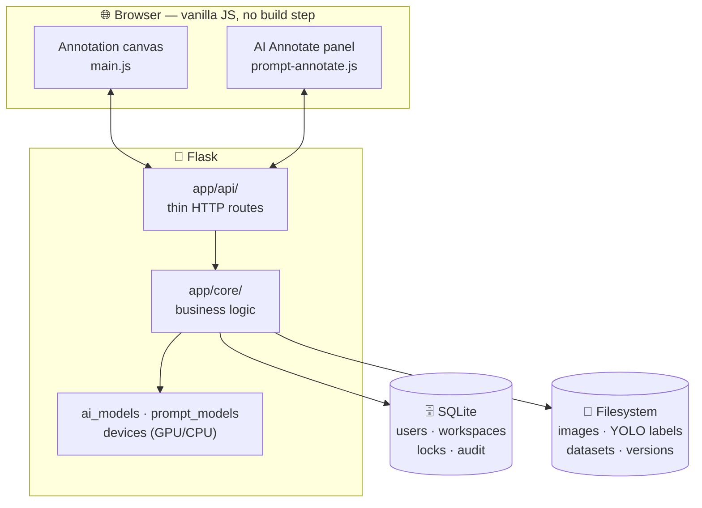

# Architecture

[← Documentation home](README.md)

- [Overview](#overview)
- [Folder structure](#folder-structure)
- [Data layout on disk](#data-layout-on-disk)
- [Maintenance](#maintenance)

Contributor notes, design decisions and known pitfalls are kept in [`CLAUDE.md`](../CLAUDE.md) at the repository root.

---

## Overview

AnnoMaster is a Flask application serving server-rendered pages that start vanilla-JavaScript front-ends. There is **no build step**: CSS and JavaScript are served as static files.



- **`app/api/` is thin, `app/core/` holds the logic.** Routes parse requests and delegate.
- **Two sources of truth, by design.** SQLite holds users, workspaces, membership, locks, audit and batch metadata; the **filesystem** holds all images and annotations.
- **Authentication** uses JWT, read from the `Authorization` header or a cookie, with owner / editor / viewer checks per workspace.

## Folder structure

```
annomaster/
├── run.py                  Entry point
├── config.py               Settings (reads .env)
├── migrate_db.py           Adds new columns/tables to an existing database
├── app/
│   ├── api/                HTTP routes — auth, workspaces, projects, uploads, media,
│   │                       annotations, classes, datasets, versions, locks, audit, AI
│   ├── core/               Business logic — paths, YOLO I/O, media index, datasets,
│   │                       versions, tags, suggestions, password reset, AI models,
│   │                       SAM3 prompting, box-prompt examples, GPU/CPU devices
│   ├── models/             SQLAlchemy — users, workspaces, images, upload batches,
│   │                       annotation locks, assignments, audit log
│   └── utils/              JWT security, public IDs, errors, logging
├── static/
│   ├── css/                Design tokens → base → layout → page sheets → modes
│   └── js/                 main.js (annotation engine) + features/ (AI Annotate,
│                           projects, workspace, settings, auth)
├── templates/              auth/ (login, register, forgot password), workspace/
│                           (dashboard, members), pages/ (annotate app, settings)
├── models/                 YOLO / SAM3 weights
├── scripts/                Backup, consistency check, v1 → v2 migration
├── docs/                   This documentation
└── workspace/              Your images and labels (not committed)
```

## Data layout on disk

```
workspace/<WS-XXXXXX>/projects/<project>/
├── Active_Work/job_<DATETIME>/
│   ├── images/
│   └── labels/          <name>.txt  ← confirmed boxes (YOLO format)
├── Completed_Datasets/job_<DATETIME>/
│   └── train/ valid/ test/  → images/ + labels/
├── Versions/<name>/     ← immutable snapshot + data.yaml
└── project.json
```

- `labels/<name>.txt` holds **confirmed** boxes only; Smart Detect suggestions awaiting review are kept beside it in `<name>.suggestions.json`, which is never exported.
- `prompt_examples.json` holds the AI Annotate box-prompt examples while the panel is open.

## Maintenance

```bash
python migrate_db.py                 # add new columns/tables to an existing database (safe to re-run)
python scripts/check_consistency.py  # report database ↔ filesystem drift
python scripts/backup.py             # snapshot the database and the workspace folder together
```
