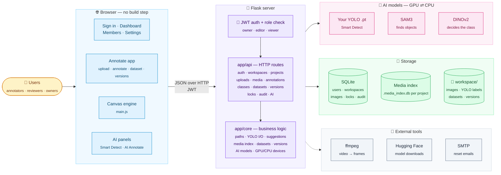
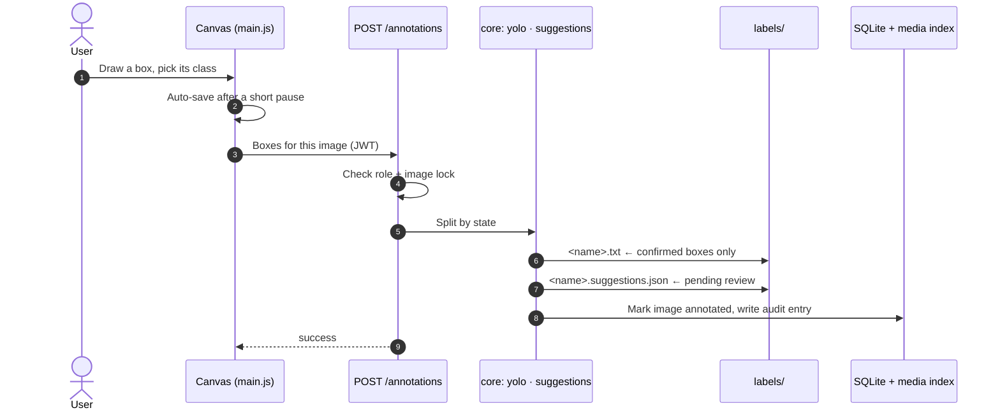
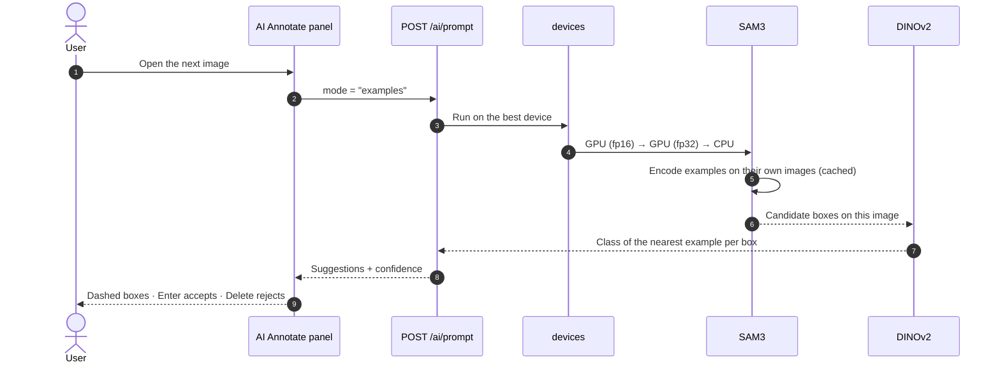
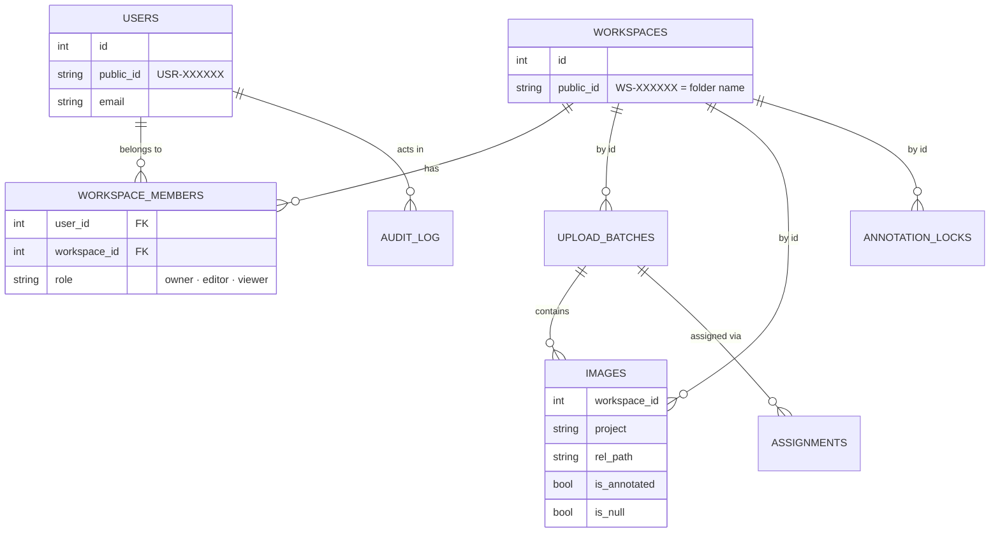

# Architecture

[← Documentation home](README.md)

- [At a glance](#at-a-glance)
- [System overview](#system-overview)
- [Layers](#layers)
- [How a request flows](#how-a-request-flows)
- [Data model](#data-model)
- [Folder structure](#folder-structure)
- [Data layout on disk](#data-layout-on-disk)
- [Maintenance](#maintenance)

Contributor notes, design decisions and known pitfalls are kept in [`CLAUDE.md`](../CLAUDE.md) at the repository root.

---

## At a glance

| | |
|---|---|
| **Type** | Self-hosted web application, single server |
| **Backend** | Python · Flask · SQLAlchemy |
| **Frontend** | Server-rendered pages + vanilla JavaScript, **no build step** |
| **AI** | PyTorch · Ultralytics (YOLO, SAM3) · DINOv2 via timm, on GPU or CPU |
| **Storage** | SQLite for accounts and teamwork; the **filesystem** for images and labels |
| **Labels** | Standard YOLO `.txt` files, readable by any YOLO tool |

## System overview



## Layers

| Layer | Responsibility | Where |
|---|---|---|
| **Pages** | Sign-in, dashboard, members and settings are standalone pages; the annotate app is one page with hash routes (`#upload`, `#annotate`, `#dataset`, `#versions`, `#classes`) | `templates/` |
| **Canvas engine** | Drawing, editing, undo/redo, auto-save, and the suggestion lifecycle (`Boxes` module) | `static/js/main.js` |
| **AI front-ends** | Smart Detect bar; AI Annotate panel for text and box prompts | `templates/pages/annotate.html`, `static/js/features/prompt-annotate.js` |
| **Auth** | JWT from the `Authorization` header or a cookie; each workspace route checks the member's role | `app/utils/security.py` |
| **API** | Thin routes: parse the request, call core, return JSON | `app/api/` |
| **Core** | All business rules. `paths.py` is the only place that builds file paths | `app/core/` |
| **AI engine** | Model loading and caching, prompt handling, and device choice: GPU with half precision, falling back to CPU | `ai_models.py`, `prompt_models.py`, `devices.py` |
| **Storage** | SQLite (hardened: WAL, foreign keys, busy timeout) plus the project folders on disk | `app/models/`, `workspace/` |

**Two sources of truth, by design.** The database holds accounts, membership, locks, audit history and batch metadata. **Images and labels live only on disk**, in standard YOLO layout, so a project folder is always usable without the application.

## How a request flows

### Saving an annotation



### Box-prompt prediction (AI Annotate)



## Data model



Only `workspace_members` uses database-enforced foreign keys; the other tables refer to a workspace **by id**. Each project also keeps a small SQLite **media index** (`.media_index.db`) for fast listing, filtering and duplicate detection.

## Folder structure

```
annomaster/
├── run.py                  Entry point
├── config.py               Settings (reads .env)
├── migrate_db.py           Adds new columns/tables to an existing database
├── app/
│   ├── api/                HTTP routes — auth, workspaces, projects, uploads, media,
│   │                       annotations, classes, datasets, versions, locks, audit, AI
│   ├── core/               Business logic — paths, YOLO I/O, media index, datasets,
│   │                       versions, tags, suggestions, password reset, AI models,
│   │                       SAM3 prompting, box-prompt examples, GPU/CPU devices
│   ├── models/             SQLAlchemy — users, workspaces, images, upload batches,
│   │                       annotation locks, assignments, audit log
│   └── utils/              JWT security, public IDs, errors, logging
├── static/
│   ├── css/                Design tokens → base → layout → page sheets → modes
│   └── js/                 main.js (annotation engine) + features/ (AI Annotate,
│                           projects, workspace, settings, auth)
├── templates/              auth/ (login, register, forgot password), workspace/
│                           (dashboard, members), pages/ (annotate app, settings)
├── models/                 YOLO / SAM3 weights
├── scripts/                Backup, consistency check, v1 → v2 migration
├── docs/                   This documentation
└── workspace/              Your images and labels (not committed)
```

## Data layout on disk

```
workspace/<WS-XXXXXX>/projects/<project>/
├── Active_Work/job_<DATETIME>/
│   ├── images/
│   └── labels/
│       ├── <name>.txt                ← confirmed boxes (YOLO format)
│       └── <name>.suggestions.json   ← AI suggestions awaiting review (never exported)
├── Completed_Datasets/job_<DATETIME>/
│   └── train/ valid/ test/  → images/ + labels/
├── Versions/<name>/                  ← immutable snapshot + data.yaml + README.md
├── project.json                      ← classes and per-project settings
├── prompt_examples.json              ← AI Annotate box-prompt examples (while the panel is open)
└── .media_index.db                   ← fast media index
```

A label file's location always follows from its image: `images/` becomes `labels/`. Exports and versions copy labels by exact `<name>.txt`, so suggestion files can never leak into a dataset.

## Maintenance

```bash
python migrate_db.py                 # add new columns/tables to an existing database (safe to re-run)
python scripts/check_consistency.py  # report database ↔ filesystem drift
python scripts/backup.py             # snapshot the database and the workspace folder together
```
